# Building a Small GPT from Scratch: What 0.8 Million Parameters Learn from Shakespeare

*A Transformer deep dive covering hand-worked attention, a from-scratch causal language model, controlled ablations, and a deployed API.*

---

**AI Engineering — Assignment 1: Build a small LLM from Scratch**

| Team member | Roll number | Contribution |
|---|---|---|
| `<<MEMBER 1 FULL NAME>>` | `<<ROLL NO>>` | `<<e.g. attention, tests, hand calculation>>` |
| `<<MEMBER 2 FULL NAME>>` | `<<ROLL NO>>` | `<<e.g. training pipeline, ablations>>` |
| `<<MEMBER 3 FULL NAME>>` | `<<ROLL NO>>` | `<<e.g. API, deployment, report>>` |

**Repository:** [github.com/laibaa1209/AI-ENG](https://github.com/laibaa1209/AI-ENG) · **Colab:** `<<Colab link>>` · **Live API:** `<<Render URL>>` · **Demo video:** `<<demo video link>>`

---

## 1. Problem and scenario

A small organisation owns a private text corpus. It is too small to justify a foundation model, but it is large enough to teach a compact model the style and vocabulary of one narrow domain. Our lead engineer asked a practical question: **can a small Transformer trained from scratch learn the next-token structure of a domain corpus well enough to generate coherent text?**

We used Tiny Shakespeare (1.1 MB, about 40,000 lines from many plays) as the stand-in "private corpus". We built a character-level GPT, *MiniGPT*, in PyTorch, writing every architectural piece ourselves. PyTorch supplies only tensors, autograd, `nn.Linear`, `nn.LayerNorm`, `nn.Embedding` and the AdamW optimiser. We load no pretrained weights and use no `transformers` model classes. The final model has **809,984 parameters**. It trains in 71 minutes on a laptop CPU, reaches **1.638 nats/character** on held-out text (perplexity 5.14), and is served by a FastAPI endpoint.

The pipeline we built:

```
raw text ─► char tokenizer ─► token ids (B,T) ─► token embedding + sinusoidal position (B,T,128)
        ─► 4 × [ pre-LN causal multi-head attention + GELU MLP, both with residuals ]
        ─► final LayerNorm ─► LM head (B,T,65) ─► softmax over next character ─► sampled text
```

## 2. Transformer foundations

### 2.1 Why Transformers: sequential depth

A recurrent network computes `h_t = tanh(W_x x_t + W_h h_{t-1})`. Step *t* cannot start until step *t−1* has finished, so processing a sequence of length *T* needs **T dependent steps**. Its sequential depth is O(T), no matter how many cores are available. Information from token 1 also has to pass through *T−1* repeated multiplications before it reaches token *T*. That is the source of vanishing gradients and short effective memory.

Self-attention computes every output position at once from three matrix products (QKᵀ, softmax, ·V). The number of *dependent* operations per layer is constant: **sequential depth O(1) per layer, O(L) for an L-layer model**. The path between any two tokens has length 1. The cost moves elsewhere. The score matrix has T×T entries, so attention costs O(T²·d) compute and O(T²) memory, while an RNN costs O(T·d²) compute and O(T·d) memory.

**Hand analysis for our setting** (T = 128, d = 128, 4 layers):

| | RNN (1 layer) | Self-attention (1 layer) |
|---|---|---|
| dependent sequential steps | 128 | 1 (three batched matmuls) |
| longest path between two tokens | 127 | 1 |
| FLOPs per sequence (dominant term) | T·d² ≈ 2.1M | T²·d ≈ 2.1M (+ 4·T·d² ≈ 8.4M for projections) |
| activation memory for mixing | T·d = 16K values | T² per head = 16K × 4 heads |

At T = 128 the arithmetic is about equal. The difference is that attention's work is **parallel**, while the RNN's is a chain of 128 small matrix-vector products.

**Measured comparison** (`experiments/why_transformers.py`, CPU, B = 8, d = 128, forward + backward):

| T | RNN dependent steps | attention dependent steps | RNN time (ms) | attention time (ms) | attention speed-up | attention-score memory |
|---|---|---|---|---|---|---|
| 32 | 32 | 1 | 51.8 | 13.1 | 4.0× | 0.1 MB |
| 64 | 64 | 1 | 86.8 | 12.9 | 6.7× | 0.5 MB |
| 128 | 128 | 1 | 119.2 | 22.7 | 5.3× | 2.0 MB |
| 256 | 256 | 1 | 256.7 | 50.5 | 5.1× | 8.0 MB |
| 512 | 512 | 1 | 644.5 | 163.9 | 3.9× | 32 MB |
| 1024 | 1024 | 1 | 2798.9 | 753.9 | 3.7× | 128 MB |

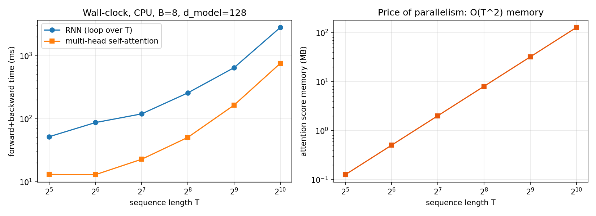
*Figure A — Left: wall-clock time. The looped RNN pays per-step overhead T times. Attention runs a few large kernels. Right: the price of parallelism, attention-score memory growing as T².*

**Observation:** attention was 3.7–6.7× faster than the looped RNN at every length. From T = 32 to 64, attention time stayed flat (13.1 → 12.9 ms), because its few large kernels were not yet saturated. The RNN grew steadily with T, because it adds one dependent step per token. Above T = 256 the picture changes: attention time grows faster than linearly (×3.2 from 256 → 512, ×4.6 from 512 → 1024, approaching the ×4 per doubling of an O(T²) cost), so its advantage shrinks from 6.7× to 3.7×. Score memory grows exactly ×4 per doubling, from 0.1 MB to 128 MB for a single layer.
**Interpretation:** on hardware built for large matrix multiplies, removing the sequential dependency matters more than the extra FLOPs, up to the point where the T² score matrix dominates memory. This is why GPT models use a fixed, bounded context window.

### 2.2 Scaled dot-product attention

Each token emits a **query** (*what am I looking for*), a **key** (*what do I contain*) and a **value** (*what I hand over if selected*): Q = XW_Q, K = XW_K, V = XW_V.

$$\text{Attention}(Q,K,V)=\text{softmax}\!\left(\frac{QK^\top}{\sqrt{d_k}} + M\right)V$$

The division by √d_k matters. If the components of q and k have unit variance, q·k has variance d_k. Without scaling, the logits grow with d_k, the softmax saturates into a near one-hot distribution, and its gradients vanish. M is the mask: 0 where attending is allowed, −∞ where it is forbidden, so that e^−∞ = 0.

### 2.3 Hand calculation (required, Figure 1)

We use 3 tokens with d_k = d_v = 2:

```
     Q            K            V
[1  0]       [1  0]       [1  2]
[1  1]       [0  1]       [3  1]
[0  1]       [1  1]       [0  4]
```

**Step 2: QKᵀ.** Entry (i, j) = q_i · k_j.

| | k₁=[1,0] | k₂=[0,1] | k₃=[1,1] |
|---|---|---|---|
| q₁=[1,0] | 1 | 0 | 1 |
| q₂=[1,1] | 1 | 1 | 2 |
| q₃=[0,1] | 0 | 1 | 1 |

**Step 3: divide by √d_k = √2 = 1.4142.**

```
[0.7071  0.0000  0.7071]
[0.7071  0.7071  1.4142]
[0.0000  0.7071  0.7071]
```

**Step 4: row-wise softmax**, using e^0 = 1, e^0.7071 = 2.0281, e^1.4142 = 4.1133.

* Row 1: (2.0281, 1, 2.0281) / 5.0562 = **(0.4011, 0.1978, 0.4011)**
* Row 2: (2.0281, 2.0281, 4.1133) / 8.1695 = **(0.2483, 0.2483, 0.5035)**
* Row 3: (1, 2.0281, 2.0281) / 5.0562 = **(0.1978, 0.4011, 0.4011)**

Every row sums to 1. Token 2's query [1,1] aligns best with k₃ = [1,1], so it puts half of its attention there.

**Step 5: output = weights · V.**

* o₁ = 0.4011·[1,2] + 0.1978·[3,1] + 0.4011·[0,4] = **[0.9944, 2.6044]**
* o₂ = 0.2483·[1,2] + 0.2483·[3,1] + 0.5035·[0,4] = **[0.9930, 2.7587]**
* o₃ = 0.1978·[1,2] + 0.4011·[3,1] + 0.4011·[0,4] = **[1.4011, 2.4011]**

(Products from 4-digit-rounded weights differ in the 4th decimal, e.g. 0.9945. The values above use unrounded weights.)

**Step 6: causal mask.** Token *i* may only attend to tokens *j ≤ i*. The −∞ entries are added before the softmax:

```
mask (1 = allowed)     masked scores                    masked weights          masked output
[1 0 0]                [0.7071    -inf    -inf]         [1.0000 0      0     ]  [1.0000 2.0000]
[1 1 0]                [0.7071  0.7071    -inf]         [0.5000 0.5000 0     ]  [2.0000 1.5000]
[1 1 1]                [0.0000  0.7071  0.7071]         [0.1978 0.4011 0.4011]  [1.4011 2.4011]
```

**Step 7: what changes for each position.**

* **Token 1** now sees only itself. Its weight vector is one-hot, so its output is just its own value [1, 2]. It went from a blend of the whole sentence to *no context at all*.
* **Token 2** loses token 3, which had held 50% of its attention. The remaining two scores are equal, so the weights become (0.5, 0.5) and the output moves from [0.99, 2.76] to [2.0, 1.5].
* **Token 3** is unchanged, because it already sees everything before it.

So the mask turns attention from "every token reads the whole sentence" into "every token reads only its past". That is exactly the information available at generation time, when the future has not been written yet. `experiments/hand_attention.py` repeats every step numerically. `tests/test_attention.py` asserts that our `scaled_dot_product_attention` reproduces these exact numbers, with and without the mask.

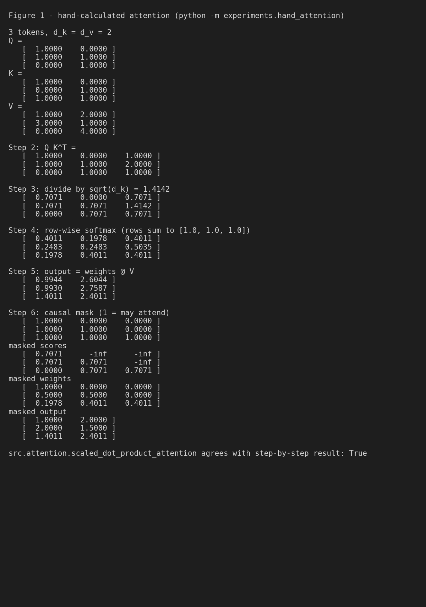
*Figure 1 — The hand calculation, reproduced step by step by `python -m experiments.hand_attention`. The last line confirms it agrees with our implementation.*

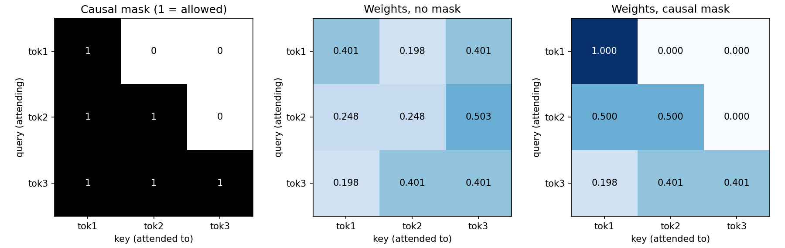
*Figure 2 — Causal mask and the attention weights with and without it. Everything above the diagonal is exactly 0.*

### 2.4 Multi-head attention

One softmax per token yields one weighted average, which is one "kind" of relationship. Multi-head attention splits d_model = 128 into h = 4 subspaces of d_head = 32. Each head runs its own attention with its own learned projections, so one head can track the previous character while another looks back to the start of the word or line. The heads are then concatenated and mixed by W_O:

$$\text{MHA}(X)=\text{Concat}(\text{head}_1,\dots,\text{head}_h)W_O,\qquad \text{head}_i=\text{Attention}(XW_Q^{(i)},XW_K^{(i)},XW_V^{(i)})$$

We project once to 128 dimensions and then *reshape*. That is mathematically identical to four separate 32-dimensional projections, but runs as one matrix multiply. The split and merge are explicit in `src/attention.py`:

```python
def split_heads(self, x):   # (B, T, d_model) -> (B, h, T, d_head)
    B, T, _ = x.shape
    return x.view(B, T, self.n_heads, self.d_head).transpose(1, 2)

def merge_heads(self, x):   # (B, h, T, d_head) -> (B, T, d_model)
    B, h, T, d = x.shape
    return x.transpose(1, 2).contiguous().view(B, T, h * d)
```

Moving the head axis in front of T lets one batched matmul compute all heads' (T×T) score matrices at once. A unit test confirms that head 1 owns exactly features 32–63 (features 8–15 in the small test model) and that merge(split(x)) == x.

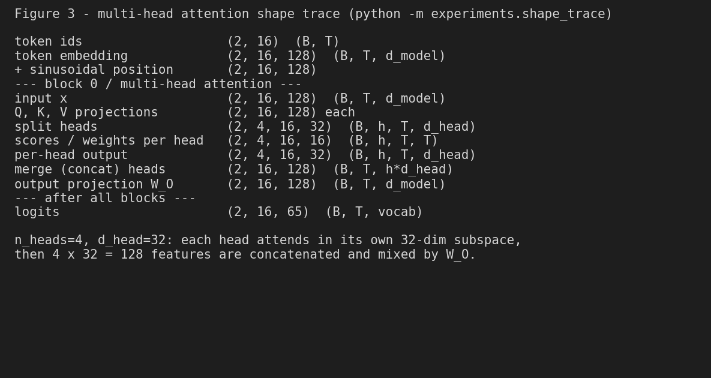
*Figure 3 — Shape trace through the first block (B = 2, T = 16), printed by the model itself (`trace=True`).*

### 2.5 Positional encoding

Attention is **permutation-equivariant**. Shuffle the input tokens and the outputs shuffle the same way, because QKᵀ never sees an index. "dog bites man" and "man bites dog" would look identical. Position must be added to the input. We implemented the sinusoidal encoding of Vaswani et al.:

$$PE_{(pos,2i)}=\sin\!\big(pos/10000^{2i/d}\big),\qquad PE_{(pos,2i+1)}=\cos\!\big(pos/10000^{2i/d}\big)$$

Each pair of dimensions is a clock running at a different speed. Wavelengths range from 2π (fast, low dimensions) to about 10000·2π (slow, high dimensions), so every position gets a unique code. Because sin(a+b) and cos(a+b) are linear in sin a and cos a, PE(pos+k) is a fixed rotation of PE(pos). That makes *relative* offsets easy for attention to detect. Figure 4(c) shows the numbers: cosine similarity between positions depends only on the distance. sim(10, 10+k) and sim(50, 50+k) are both (1.0, 0.970, 0.897, 0.737, 0.608) for k = 0, 1, 2, 5, 20. Similarity falls smoothly with distance and is translation-invariant, which is the systematic change in representations the assignment asks for. We add PE to token embeddings initialised N(0, 1), so both terms have comparable scale and neither drowns out the other. We also implemented a learned positional embedding for the ablation (§7.4).

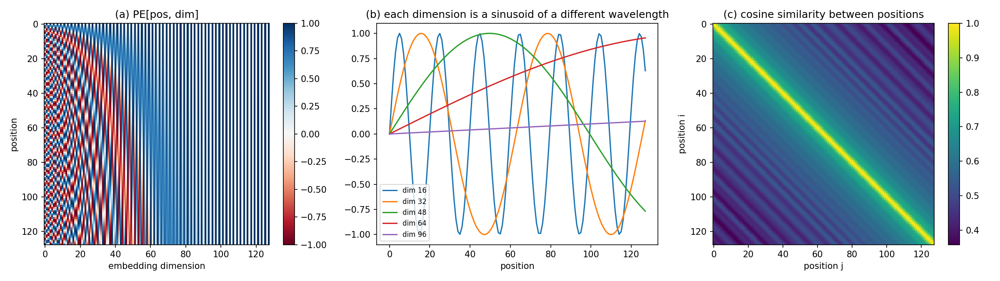
*Figure 4 — (a) The 128×128 PE matrix. (b) Individual dimensions are sinusoids of different wavelength. (c) Cosine similarity between position codes: a band around the diagonal, the same everywhere.*

### 2.6 The Transformer block

```
            x ──────────────┐                     ┌─────────────────┐
            │               │                     │                 │
       LayerNorm            │                LayerNorm              │
            │               │                     │                 │
  causal multi-head attn    │          Linear 128→512 · GELU        │
  (4 heads × 32 dims)       │          Linear 512→128 · dropout     │
            │               │                     │                 │
         dropout            │                     │                 │
            └──────(+)◄─────┘                     └──────(+)◄───────┘
                    │                                    │
                    └──────────────── x' ────────────────┴──► next block
```

* **Attention** mixes information *between* positions. **The FFN** transforms each position *independently* (a 4× expansion, GELU, projection back). In our model it holds two thirds of each block's parameters.
* **Residual connections** (x + f(x)) give gradients an identity path through all layers. Each sublayer only learns a *correction* to the running representation.
* **Pre-LayerNorm** (normalise *before* each sublayer, as in GPT-2) instead of the original post-LN. Because the residual stream itself is never normalised, the gradient through the identity path is exactly 1, and training is stable without a long warm-up (Xiong et al., 2020). A final LayerNorm comes before the LM head.

Per block: attention 4·(128·128 + 128) = 66,048, FFN 128·512 + 512 + 512·128 + 128 = 131,712, two LayerNorms 512. Total **198,272**, matching the printed summary (Figure 5).

### 2.7 BERT vs GPT: two objectives, two masks

| | BERT (masked LM) | GPT (causal LM) |
|---|---|---|
| attention mask | none: every token sees the whole sequence | lower-triangular: token t sees 1…t |
| input corruption | 15% of tokens replaced by [MASK] | none |
| loss on | only the masked positions | every position, target = next token |
| good at | understanding, representations, classification | generation, left to right |

The constraint follows from the objective. BERT hides the *answer in the input* (the [MASK] token), so letting every token see every other token is safe. It even helps, because a masked word can use context from both sides. GPT's targets are the *inputs shifted by one*: the answer for position t is literally token t+1, which sits in the same input sequence. If position t could attend to position t+1, the model would simply copy it. The causal mask is what turns "predict the next token" into a real prediction task.

**Experiment** (`experiments/mask_comparison.py`). One tiny Transformer (2 layers, d_model 64, 600 steps), trained three ways. Only the mask and the objective change:

| Model | Attention mask | Objective | Train loss (own objective) | Next-token loss at last position (val) | Sample from "ROMEO:" |
|---|---|---|---|---|---|
| **GPT** | causal | next token, all positions | 2.046 | **2.074** | `ROMEO:\nThy mome kis henll iforce neamanty id I the fart\nI hat you for beare…` |
| **LEAK** | bidirectional | next token, all positions | **0.052** | 2.630 | `ROMEO::: O::::::::::::::::::::::::::::::::…` |
| **BERT** | bidirectional | 15% of inputs → [MASK], predict those | 2.946 | n/a (not a next-token model) | n/a |

For reference, a uniform guess scores ln 65 = 4.174.

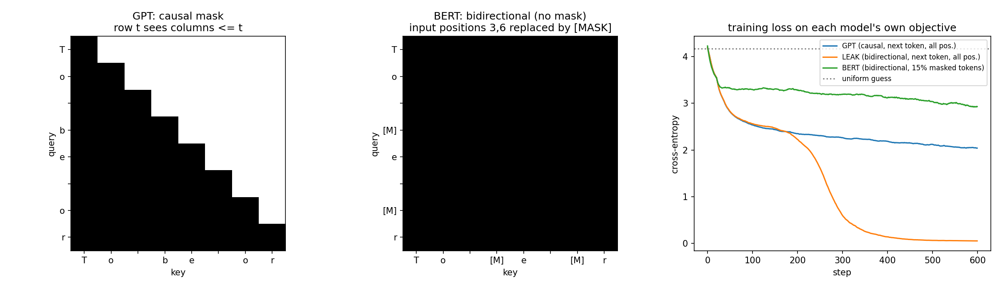
*Figure B — Left: GPT's causal mask. Middle: BERT's full attention, with [MASK] in the input instead of in the attention. Right: training loss under each model's own objective.*

**Observation:** the LEAK model's training loss fell to 0.052, 40× lower than GPT's 2.046, and far below anything achievable on real text. At the last position, where nothing to the right exists, its loss was 2.630, 0.56 nats *worse* than the honest causal model (2.074). Its sample collapses into a run of colons. The MLM model reached 2.946 on its masked positions.
**Interpretation:** the bidirectional next-token model did not learn language. It learned to read the answer from the next position. At the last position, where no future token exists (exactly the situation during generation), its loss is far worse than the honest causal model's, and its samples are gibberish. BERT's loss (2.95) is *higher* than GPT's in this short run. That is not because bidirectional context hurts. MLM only supervises the 15% of positions that were masked, so in 600 steps it received about 6.7× fewer training targets than GPT (184K vs 1.23M). This known sample inefficiency of MLM is one reason GPT-style training scales well. MLM also cannot generate left to right, because it was never trained to predict a token from its left context alone. So GPT's causal mask is not an optimisation trick: without it the training objective is meaningless.

## 3. Implementation

| Component | Our implementation (file) |
|---|---|
| Tokenizer | deterministic character-level, vocabulary = sorted unique characters (65), no special tokens (`tokenizer.py`) |
| Embedding | `nn.Embedding(65, 128)`, N(0, 1) init (`gpt.py`) |
| Position | sinusoidal, fixed buffer; learned variant for the ablation (`positional_encoding.py`) |
| Self-attention | separate Q/K/V `nn.Linear`, explicit QKᵀ/√d_k, `masked_fill(−∞)`, softmax, ·V (`attention.py`) |
| Multi-head | `split_heads` / `merge_heads` with view/transpose, W_O output projection |
| FFN | Linear(128→512) → GELU → Linear(512→128) → dropout |
| Normalisation | pre-LN `nn.LayerNorm` before each sublayer + final LayerNorm |
| Residuals | `x = x + attn(ln1(x))`, `x = x + ffn(ln2(x))` (`transformer_block.py`) |
| Causal mask | `torch.tril(ones(T,T))`, boolean, True = may attend |
| LM head | Linear(128→65), no bias, untied |
| Loss | token-level cross-entropy over (B·T) positions with shifted targets |
| Generation | autoregressive loop, context cropped to the last 128 tokens, temperature, optional top-k, greedy mode |

**Tokenizer.** We used characters rather than BPE subwords. The corpus is only 1 MB, so a subword vocabulary of thousands of tokens would leave most embedding rows trained on only a handful of examples. Characters also make every prediction inspectable. The 65 symbols are `\n`, space, `!$&',-.3:;?`, A–Z and a–z. The cost is longer sequences: 128 characters is only about 25 words of context. We need no special tokens because training draws fixed-length windows from one continuous stream, so nothing has to be padded or delimited. Unknown characters raise an error and the API returns HTTP 400. We considered silently dropping them, but rejected that because it hides problems.

**Masking.** The mask is built inside `MultiHeadAttention.forward` for the current length T and broadcast over batch and heads, so it also covers the shorter sequences seen during generation. Two tests prove causality end to end on the full model. (1) The weights above the diagonal are exactly 0 in every head. (2) **Changing every token after position t leaves the logits at positions ≤ t bit-for-bit identical (atol 1e-6), while the logits after t do change.** A control test shows that the bidirectional variant fails check (2). This satisfies acceptance test 6: generation never attends to future tokens.

**Training loop** (`train.py`):

```python
for step in range(max_steps + 1):
    set lr = warmup_then_cosine(step)
    if step % eval_interval == 0: estimate train/val loss on fixed batches, sample from "ROMEO:", log JSON
    x, y = get_batch(train_data)               # y = x shifted left by one
    logits, loss = model(x, y)                 # CE over all B·T positions
    opt.zero_grad(); loss.backward()
    clip_grad_norm_(model.parameters(), 1.0)
    opt.step()
save checkpoint {weights, config, vocabulary, metrics}; plot loss curve
```

**Next-token dataset.** For a random offset i, `x = data[i : i+T]` and `y = data[i+1 : i+T+1]`. Each window therefore holds T training examples: predict character 2 from character 1, character 3 from characters 1–2, …, character T+1 from characters 1–T. The causal mask is what keeps these T examples honest when they are computed in parallel. A unit test feeds the sequence 0, 1, 2, … and asserts `y == x + 1`.

**Debugging gate.** Before any long run, `tests/test_overfit.py` trains a 2-layer model on one fixed batch of 8×32 characters. Loss falls from **2.79 to 0.008** in 150 steps. A broken shift, mask or gradient path would stall it.

## 4. Dataset and preprocessing

* **Source:** Tiny Shakespeare, the `input.txt` behind the Hugging Face `tiny_shakespeare` dataset card (Karpathy's char-rnn), downloaded automatically by `src/dataset.py`.
* **Size:** 1,115,394 characters, 40,000 lines, 65 unique characters.
* **Split:** contiguous. The first 90% (1,003,854 characters) is training and the last 10% (111,540 characters) is validation. We split contiguously rather than by random windows so that validation text is never seen during training, apart from the one boundary.
* **Filtering:** none. Speaker names, capitalisation and line breaks are kept on purpose, because they are part of the domain "style".
* **Context length:** 128 characters per window. Batches are sampled at random offsets each step, so one "epoch" is not a fixed concept. 5,000 steps × 32 × 128 = 20.5M training characters, about 20 passes over the training text.

## 5. Training setup

| Setting | Value | Why |
|---|---|---|
| hardware | Intel Core i7-8665U laptop CPU (4 cores / 8 threads, 16 GB RAM), **no GPU** | what we had; the Colab notebook re-trains on a T4 |
| context_length | 128 | assignment default; about one or two lines of verse |
| d_model / heads / layers | 128 / 4 / 4 | assignment defaults; ~0.8 s per step on our CPU |
| ffn_dim | 512 (4 × d_model) | standard ratio |
| dropout | 0.1 | the corpus is small and a 0.8M model can memorise it |
| batch size | 32 sequences = 4,096 characters per step | the largest that kept a step under 1 s on CPU |
| optimizer | AdamW, β = (0.9, 0.95), weight decay 0.1 | β₂ = 0.95 reacts faster to gradient-scale changes (GPT-3 setting) |
| learning rate | 1e-3, 200 linear warm-up steps, cosine decay to 1e-4 | for a model this small, 3e-4 was slow (measured in §7.5); warm-up avoids early Adam instability |
| gradient clipping | global norm 1.0 | guards against loss spikes |
| steps | 5,000 | val loss was flattening (Figure 6) |
| evaluation | every 250 steps, 50 fixed batches per split, plus a sample | identical eval batches make points comparable |
| seed | 1337 | full run reproducible with one command |
| checkpoint | `checkpoints/tiny_gpt.pt`: weights + config + vocabulary + metrics, 3.3 MB, committed | a fresh process can load and generate |

Reproduce: `python -m src.train --config configs/tiny_gpt.yaml`.

## 6. Results

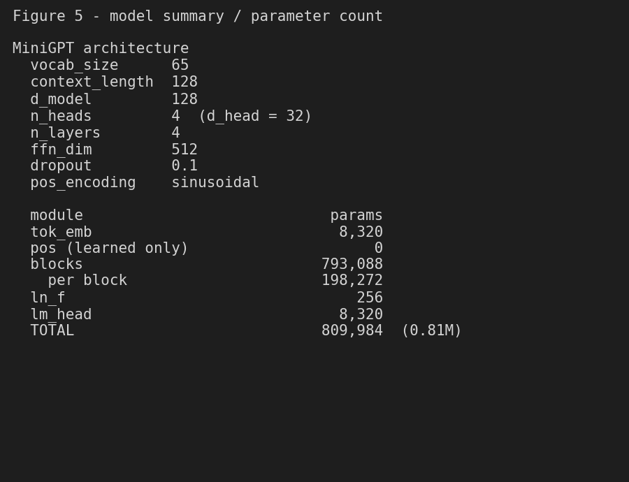
*Figure 5 — Model summary: 809,984 parameters, 98% of them in the four blocks. The sinusoidal position encoding has no parameters.*

| Metric | Value |
|---|---|
| parameters | 809,984 (0.81M) |
| wall-clock training time | 4,254 s (70.9 min) on CPU |
| throughput | 4,814 characters/s |
| final train loss (estimate, 50 batches) | 1.4448 |
| final validation loss (estimate, 50 batches) | 1.638 |
| **full validation set** loss / perplexity / bits per char | **1.6348** / **5.13** / **2.36** |
| baseline: uniform guess | ln 65 = 4.174 nats (perplexity 65) |

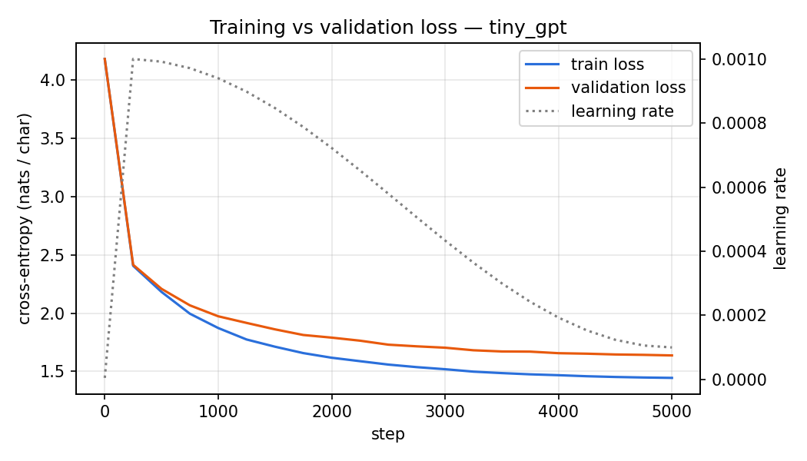
*Figure 6 — Training and validation loss (left axis) and learning rate (right axis, dotted).*

**Observations.**
* Loss fell from 4.182 at step 0, which is ln 65 for a uniform guess, to 2.415 by step 250, 1.974 by step 1,000 and **1.638 at step 5,000** (validation).
* Train and validation losses were within 0.01 until about step 500. The gap then widened gradually to **0.19 nats** (train 1.445, validation 1.638).
* Validation loss was still falling at the end (−0.005 over the last 250 steps), so the model never entered the regime where validation loss rises.
* Evaluated on the *entire* validation split (871 non-overlapping 128-character windows), the loss is **1.6348 nats/char**: perplexity **5.13**, or **2.36 bits per character**. This agrees with the 50-batch estimate.
* Training took **4,254 s (70.9 min)** at 4,814 characters/s. The process peaked at 529 MB of RAM.

**Interpretation.** A perplexity of 5.1 means that, on average, the model is as uncertain as a uniform choice among about 5 characters, down from 65 at the start. The early, steep drop matches learning character frequencies and common bigrams; the long tail is learning words and format. The widening gap shows the model starting to memorise training-set specifics. With 0.81M parameters and only 1M training characters (about 20 passes), more data or stronger regularisation would help more than more steps.

### Samples during training (prompt "ROMEO:", temperature 0.8)

**Step 0** (val loss 4.182)

```
ROMEO:oEVHcfqZKv?Fb,3Bd.Bo'SZ!B fLDG:Vtz,VqcGMZwmE,a-:g?
mrESlchn!D:Pr3vQTMfLbxvh.;mA;
nRnrjgVg$Ju:Kc?.x'OOFum
```

**Step 250** (val loss 2.415)

```
ROMEO:
CAs he theat ilus nthee ame wich dicess minde,
Th ons shers thind ais ustind grimus.
J:

O, nthit ivou,
```

**Step 1000** (val loss 1.974)

```
ROMEO:
I and the my duke and the his ween me soin.

CABIO:
Whith is is the stake, the with with wendlus.

PAUR
```

**Step 2500** (val loss 1.730)

```
ROMEO:
Drother and to be a gentleman.

MENIUS:
A the dare Britther;
Uf not a bid thee the says affer merry str
```

**Step 5000** (val loss 1.638)

```
ROMEO:
'Tis one do, and the partice his breathe,
Are out houses of the mock sour
Shall unought on this joys hi
```

### Final samples from five fixed prompts (Figure 8)

**Prompt 1: 'ROMEO:'  (temperature 0.8, seed 0)**

```
ROMEO:
Why make the prevence of your any, in I to thee,
For to givent be receity to be the senself.

RICHARD:
I pray thee, and this did trunk; my father well.

RIVERS:
He me to the hear and much aut no.

SICINIUS:
Thanks is thine not say that of me;
Or my
```

**Prompt 2: 'JULIET:\nO '  (temperature 0.8, seed 1)**

```
JULIET:
O my word here to unage, that me, by my shall with a virtue,
And he mother mine, and long her, we shall with the
Too was hither in a sishouts there: place your head
many my bark with thou the fair three with my pass,
And I do territor it whipted desire
```

**Prompt 3: 'KING HENRY:\nWhat news'  (temperature 0.8, seed 2)**

```
KING HENRY:
What news do my lords, her you to speak of the kissning.

DUKE VINCENTIO:
How so the batts with what he with the fault,
By the may set that dank the sigh fast,
And say my chargelign like made make with me.

WARWICK:
How no thou drawnesss in commondion of asta
```

**Prompt 4: 'First Citizen:\n'  (temperature 0.8, seed 3)**

```
First Citizen:
Then is but say my liege, that I'll myself,
When think the like alther after the worth,
Thou art the Lord Vantage,
For small'd prots of the to penduation:
And we may hate lips to me justices in the break,
And, very hanged blings the doth word men ang
```

**Prompt 5: 'To be, or not to be'  (temperature 0.8, seed 4)**

```
To be, or not to be it, with was
Yet do whose racks fair in the him life well
Have her hate speak be in the scorn a wrong
Till death all made,
And that I know, when that would hope have
Till cannot like the ead to orde look putcher;
The comes honour, that is the voice
```

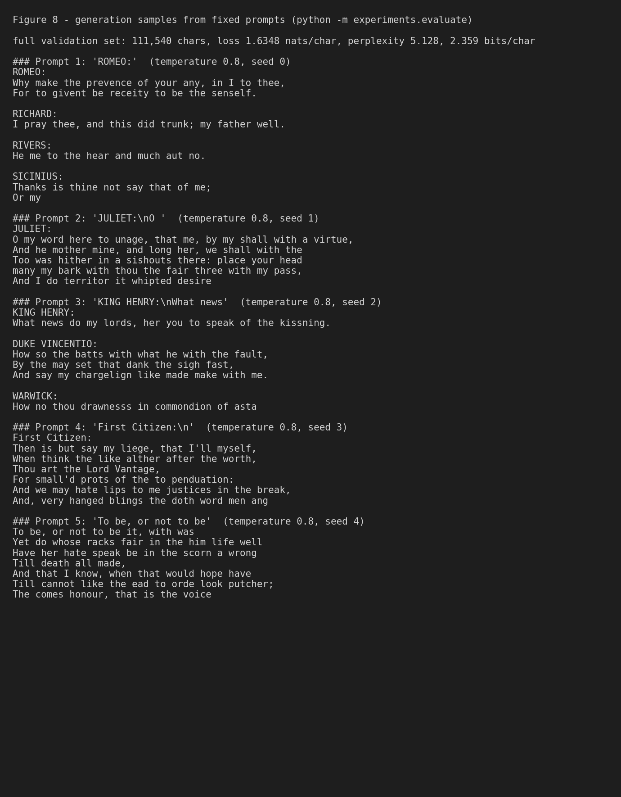
*Figure 8 — Five fixed prompts, temperature 0.8, seeds 0–4 (`python -m experiments.evaluate`).*

### Attention inspection (Figure 7)

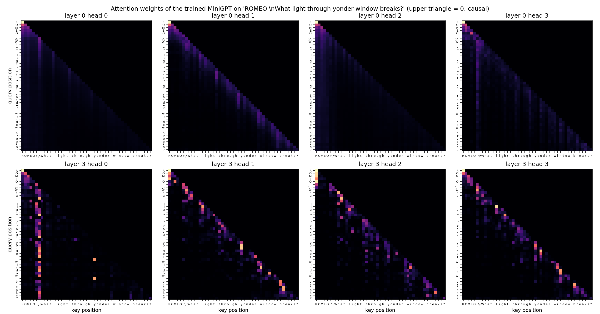
*Figure 7 — Attention of the trained model on "ROMEO:\nWhat light through yonder window breaks?". Top row: layer 0. Bottom row: layer 3. Rows are queries, columns are keys. The upper triangle is exactly zero.*

Per-head statistics over the 46-character prompt (`python -m experiments.attention_visualization`). For comparison, uniform causal attention would give a mean distance of about 11 and a previous-token weight of about 0.09.

| Layer | Head | Mean look-back distance | Weight on previous char | Weight on self | Weight on first char |
|---|---|---|---|---|---|
| 0 | 0 | 12.08 | 0.084 | 0.104 | 0.098 |
| 0 | 1 | 4.83 | 0.168 | 0.181 | 0.043 |
| 0 | 2 | 13.13 | 0.078 | 0.098 | 0.109 |
| 0 | 3 | 8.05 | 0.116 | 0.116 | 0.040 |
| 1 | 0 | 2.41 | 0.200 | 0.315 | 0.037 |
| 1 | 1 | 4.74 | 0.149 | 0.183 | 0.048 |
| 1 | 2 | 3.57 | 0.191 | 0.190 | 0.045 |
| 1 | 3 | 1.96 | 0.325 | 0.203 | 0.021 |
| 2 | 0 | 1.97 | 0.343 | 0.179 | 0.022 |
| 2 | 1 | 2.49 | 0.324 | 0.167 | 0.030 |
| 2 | 2 | 1.94 | 0.422 | 0.119 | 0.025 |
| 2 | 3 | 2.73 | 0.282 | 0.175 | 0.058 |
| 3 | 0 | 14.16 | 0.051 | 0.085 | 0.039 |
| 3 | 1 | 3.61 | 0.257 | 0.181 | 0.060 |
| 3 | 2 | 4.67 | 0.190 | 0.167 | 0.096 |
| 3 | 3 | 3.87 | 0.267 | 0.143 | 0.028 |

**Observation.** The layers behave differently.
* **Layer 0** is diffuse. Heads 0 and 2 have mean look-back distances of 12–13, close to uniform averaging. In the figure they appear as faint, even vertical bands.
* **Layers 1 and 2** are sharply local. Every head puts 0.15–0.42 of its weight on the immediately preceding character, 2–5× the uniform level. Mean distances are around 2.
* **Layer 3** splits roles. Heads 1–3 follow the recent characters of the current word: the bright cells sit just below the diagonal and reset at each space. Head 0 has the longest reach (mean distance 14.2) and, as the bright vertical stripe shows, it attends to the `\n` after "ROMEO:" from almost every later position.

**Interpretation** (hypotheses consistent with the evidence, not proven). Layer 0 builds a rough "bag of recent characters" summary. Layers 1–2 act as n-gram detectors that spell out the current word. Layer 3, head 0 uses the line break as an anchor. Measuring distance from the start of the line is exactly what is needed to predict Shakespeare's line lengths and the speaker-name → colon → newline format. The upper triangle is zero in every head, which also confirms the causal mask in the trained model (Figure 2 requirement).

## 7. Ablation study

Every run uses the same seed, data, optimiser, lr schedule (1e-3, cosine), dropout 0.1 and budget: **1,000 steps at batch 16**. Each run changes **exactly one factor** from the baseline (4 layers, 4 heads, context 128, sinusoidal). Each run is a fresh process so that peak memory is measured cleanly. Ablations use a shorter budget than the final model, so their absolute losses are higher than §6. Only the *differences* matter here. "Peak RSS" is the process's peak resident memory on CPU. "Attn-score mem" is the analytic size of all layers' (B, h, T, T) score tensors in one forward pass.

| Experiment | Setting | Params | Train loss | Val loss | Δ val vs baseline | Train time (s) | Tokens/s | Peak RSS (MB) | Attn-score memory (MB) |
|---|---|---|---|---|---|---|---|---|---|
| Depth | n_layers = 2 | 413,440 | 2.206 | **2.229** | +0.096 | 221 | 9,255 | 366 | 8 |
| Depth | n_layers = 4 (baseline) | 809,984 | 2.103 | **2.133** | baseline | 448 | 4,574 | 423 | 16 |
| Depth | n_layers = 6 | 1,206,528 | 2.060 | **2.105** | -0.028 | 666 | 3,073 | 480 | 24 |
| Heads | n_heads = 2 | 809,984 | 2.118 | **2.148** | +0.016 | 422 | 4,848 | 422 | 8 |
| Heads | n_heads = 4 (baseline) | 809,984 | 2.103 | **2.133** | baseline | 448 | 4,574 | 423 | 16 |
| Heads | n_heads = 8 | 809,984 | 2.112 | **2.143** | +0.010 | 466 | 4,398 | 453 | 32 |
| Context length | context_length = 64 | 809,984 | 2.090 | **2.107** | -0.026 | 209 | 4,892 | 376 | 4 |
| Context length | context_length = 128 (baseline) | 809,984 | 2.103 | **2.133** | baseline | 448 | 4,574 | 423 | 16 |
| Context length | context_length = 256 | 809,984 | 2.153 | **2.207** | +0.075 | 828 | 4,948 | 626 | 64 |
| Position method | pos_encoding = sinusoidal (baseline) | 809,984 | 2.103 | **2.133** | baseline | 448 | 4,574 | 423 | 16 |
| Position method | pos_encoding = learned | 826,368 | 2.218 | **2.236** | +0.103 | 402 | 5,092 | 421 | 16 |
| Learning rate | lr = 0.0003 | 809,984 | 2.373 | **2.369** | +0.236 | 740 † | 2,769 † | 425 | 16 |
| Learning rate | lr = 0.001 (baseline) | 809,984 | 2.103 | **2.133** | baseline | 448 | 4,574 | 423 | 16 |
| Seed (noise floor) | seed = 1337 (baseline) | 809,984 | 2.103 | **2.133** | baseline | 448 | 4,574 | 423 | 16 |
| Seed (noise floor) | seed = 2 | 809,984 | 2.109 | **2.143** | +0.010 | 770 † | 2,661 † | 417 | 16 |

† These two runs were made later, while the laptop was also running other jobs. Their losses are valid, but their time and throughput are not comparable with the other rows, which ran back-to-back on an otherwise idle machine.

**Noise floor.** Re-running the baseline with a different seed moved validation loss by **0.010** (2.133 → 2.143). Below, we treat differences under about 0.02 as indistinguishable from noise. (Two seeds give only a rough estimate; a proper confidence interval needs more repeats than our CPU budget allowed.)

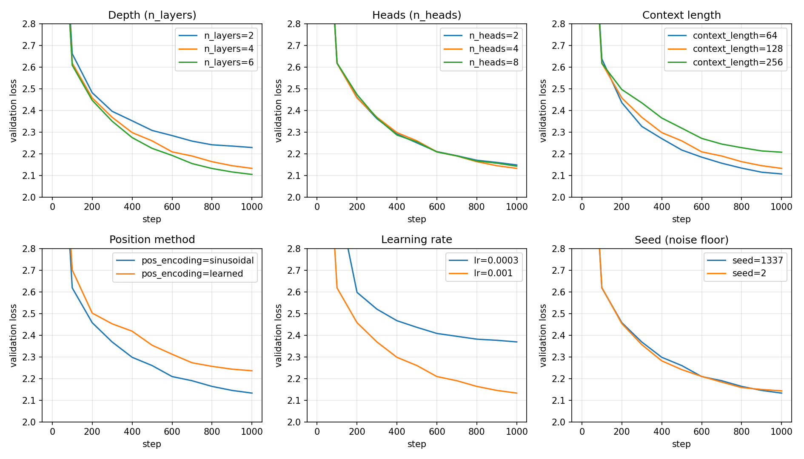
*Figure 9 — Validation-loss curves for every ablation, grouped by experiment.*

### 7.1 Depth: 2 vs 4 vs 6 blocks

**Observation.** Parameters (413K → 810K → 1.21M) and training time (221 → 448 → 666 s) both grew linearly with depth, and throughput fell to roughly half and then a third. Validation loss improved from 2.229 to 2.133 (−0.096, about 10× the noise floor) and then to 2.105 (−0.028, about 3× noise). Six blocks led at every evaluation point (Figure 9).

**Interpretation.** Depth is the most effective factor we tested, but with sharply diminishing returns at this budget. Doubling from 2 to 4 layers bought 3.4× more improvement than adding 50% more layers after that. Each extra block adds one more round of "gather from other positions, then transform", so features can be composed: characters → word pieces → word and line context. Figure 7 shows that layers really do specialise (diffuse → local → line-anchored). Why the third step helps less is a hypothesis we did not test: with only 1,000 steps, the extra capacity may not be fully used yet. We kept 4 layers for the final model. Six layers cost 50% more time for a 1.3% loss improvement, and the assignment recommends 4.

### 7.2 Heads: 2 vs 4 vs 8 (d_model fixed at 128)

**Observation.** Validation loss was 2.149 / 2.133 / 2.143. All differences are ≤ 0.016, the same size as the seed noise, and the three curves overlap throughout (Figure 9). Parameter count is identical, because the heads split the same 128 dimensions. Attention-score memory doubled with each doubling of heads (8 → 16 → 32 MB), and throughput fell slightly (4,848 → 4,574 → 4,398 characters/s). The final samples (`outputs/samples/ablation_samples.md`) show no qualitative difference either.

**Interpretation.** At this scale, the number of heads made **no measurable difference** to quality, only to cost. One reason is that more heads means narrower heads: 8 heads have only 16 dimensions each to form their queries and keys. More, weaker heads and fewer, stronger heads seem to balance out here. 4 heads is a sensible default; 8 heads double the T×T memory for nothing.

### 7.3 Context length: 64 vs 128 vs 256

**Observation.**
* *Validation loss* (1,000 steps): **2.107 / 2.133 / 2.207**. Shorter context was better, and 256 was clearly worse (+0.075).
* *Throughput* was almost constant per character: 4,892 / 4,574 / 4,948 characters/s. Wall-clock time per step therefore doubled with each doubling of T (209 → 448 → 828 s).
* *Memory*: attention scores grew exactly ×4 per doubling (4 → 16 → 64 MB). Peak process memory grew 376 → 423 → 626 MB, an increase that accelerates as the T² terms take over.

**Interpretation.**
* *Throughput:* at d_model = 128 and T ≤ 256, the T² attention work is still smaller than the per-token projections and FFN (≈ 12·d² ≈ 197K FLOPs per token, against 2·T·d ≈ 65K at T = 256). So cost per character barely changed. The quadratic term appears in *memory* first, which matches the RNN-vs-attention measurement in §2.1.
* *Loss:* longer windows did **not** help within 1,000 steps. Two plausible reasons, which we did not test separately:
  1. Early in training the model mostly uses the last few characters (Figure 7). A 256-key softmax spreads attention over more irrelevant keys, so the useful local signal is harder to find.
  2. With batch size fixed at 16 sequences, a 256-character window adds more tokens per step, but they are highly correlated with each other, so it is not twice as much independent signal.
* This measures *speed of learning*, not the ceiling. Long-range benefit (keeping a speaker or rhyme consistent) needs a model that has already mastered local structure, which our budget does not reach.

We kept 128 for the final model. The 64-character advantage is only about 2.5× noise and was measured on a short budget, and 128 characters fit a full verse line plus speaker tag.

### 7.4 Position method: sinusoidal vs learned (optional)

**Observation.** Learned positions added 16,384 parameters (128 positions × 128 dimensions) and finished **0.103 worse** (2.236 vs 2.133). The learned curve was above the sinusoidal one at every evaluation point (Figure 9).

**Interpretation.** Sinusoidal encoding gives the model smooth, structured, relative-distance information from step 0 (§2.5). Learned position vectors start as random N(0, 1) noise of the same size as the token embeddings, so for the first several hundred steps they *corrupt* the input more than they inform it. GPT-2 uses learned positions successfully at a far larger training budget. Our result does not contradict that: it shows that the fixed prior is worth a lot when data and steps are scarce.

### 7.5 Learning rate: 3e-4 vs 1e-3 (supports the configuration choice)

**Observation.** With the handout's suggested starting rate of 3e-4, validation loss after 1,000 steps was **2.369**, against **2.133** at 1e-3 (+0.236, the largest effect we measured). Train and validation losses were equal (2.373 vs 2.369), so the gap is not overfitting.

**Interpretation.** At 3e-4 the model is simply underfit at this budget. A model this small (0.8M parameters, pre-LN, gradient clipping) tolerates a larger step size, which is why our final configuration uses 1e-3 with warm-up and cosine decay.

### 7.6 Optional: greedy vs temperature sampling

Prompt "ROMEO:", 400 new characters. Statistics are averaged over 3 seeds for the stochastic strategies. *Distinct 4-grams* is the share of unique 4-character substrings (higher means more diverse). *Repeated-text fraction* is the share of positions whose previous 8 characters already occurred earlier (a loop detector).

| Strategy | Distinct 4-grams | Repeated-text fraction |
|---|---|---|
| greedy (argmax) | 0.249 | **0.600** |
| temperature 0.5 | 0.780 | 0.008 |
| temperature 0.8 (our default) | 0.871 | 0.004 |
| temperature 1.0 | 0.920 | 0.002 |
| temperature 1.5 | 0.973 | 0.000 |

**Observation.** Greedy decoding gets stuck in a loop ("…the shall be the see / That the shall be the seem to the world the see…"), and 60% of its text repeats an earlier 8-gram. Raising the temperature increases diversity monotonically. At 1.5 the text stops being words ("Tlan, o'ca means! Paid Ighleve greech").

**Interpretation.** The single most probable next character is usually a space, "e", "t" or "h". Always taking it walks into a high-probability cycle that the 128-character window cannot escape. Sampling keeps the less likely but necessary choices. Temperature 0.8 is the best trade-off we measured: almost no repetition (0.4%), while the samples in §6 are mostly real words.

## 8. Failure analysis

**F1 — Repetition loops under greedy decoding.** *Evidence:* §7.6. Greedy output repeats "the shall be the see" and 60% of it is repeated text. *Likely cause:* the model is trained with teacher forcing on real text and never on its own outputs (exposure bias). Once a high-probability cycle begins, the most likely continuation is to continue it. *Mitigation used:* temperature sampling (0.8) by default.

**F2 — Invented words and only local coherence.** *Evidence:* "prevence", "receity", "senself" (prompt 1); "unage", "sishouts", "territor" (prompt 2). Lines are metrically plausible but say nothing. *Likely cause:* character-level modelling at 2.36 bits/char. A five-letter word gives about five chances to pick a plausible but wrong letter, and 0.81M parameters cannot store a large lexicon, let alone meaning. A subword tokenizer and a larger model are the standard fixes.

**F3 — Characters from different plays share one scene.** *Evidence:* prompt 1 goes RICHARD → RIVERS → SICINIUS (*Richard III* and *Coriolanus*), and prompt 3 has KING HENRY, DUKE VINCENTIO and WARWICK. *Likely cause:* training windows are random 128-character slices taken across the whole corpus. The model never sees a full scene, and its context ends after about 25 words, so it cannot keep a cast consistent.

**F4 — Out-of-domain prompts are ignored.** *Evidence:* the handout's example prompt `"The future of artificial intelligence"` gives *"To mock'd him against me and God, that are the holy 'Warwick, …"*. The model drops the topic within a line and returns to Shakespeare (`outputs/samples/out_of_domain_prompt.txt`). *Likely cause:* by design, the model knows only its 1 MB domain. Prompts with characters outside the 65-symbol vocabulary (e.g. "é") are rejected with a clear error.

**F5 — Generalisation gap.** *Evidence:* a 0.19-nat gap between train and validation loss at step 5,000 (Figure 6). *Likely cause:* a small corpus seen about 20 times. Validation loss was still improving, so this is the onset of memorisation, not harmful overfitting yet.

**Induced failure — attention leakage.** The bidirectional LEAK model in §2.7 shows what happens if the causal mask is wrong: near-zero training loss, a model that cannot generate.

## 9. Engineering packaging

**CLI.** `python -m src.generate --prompt "ROMEO:" --max-new-tokens 200 [--temperature 0.8] [--top-k K] [--greedy] [--seed S]`. It prints the prompt, the generation, and everything needed to reproduce the run: parameter count, context length, architecture, decoding settings, seed and the checkpoint's validation loss.

```
$ python -m src.generate --prompt "ROMEO:" --max-new-tokens 150
Prompt: ROMEO:
Generated: ROMEO:
The world: now go will to this ralief,
It they holy 'Was from the common and with your lifes
That I would have my death on Marcius there,
The most of

model parameters: 0.81M (809,984)
context length: 128
layers/heads/d_model: 4/4/128
decoding: temperature=0.8 top_k=None  seed=42
checkpoint val loss: 1.6376  (perplexity 5.143)
```

**REST API** (`api/app.py`, FastAPI). The model loads once at start-up. Endpoints: `POST /generate`, `GET /health`, `GET /docs` (Swagger) and a small HTML playground at `/`. Pydantic checks every input at the trust boundary: prompt 1–500 characters, max_new_tokens 1–1000, temperature in (0, 2], top_k 1–65. Characters outside the vocabulary return HTTP 400 with the offending characters listed, instead of a 500 error.

```bash
curl -X POST https://<your-service>.onrender.com/generate -H "Content-Type: application/json" \
     -d '{"prompt":"ROMEO:","max_new_tokens":150,"temperature":0.8,"seed":0}'
```

```
$ uvicorn api.app:app --port 8765 &
$ curl http://127.0.0.1:8765/health
{"status": "ok", "parameters": 809984, "context_length": 128, "n_layers": 4, "n_heads": 4, "d_model": 128, "vocab_size": 65, "val_loss": 1.6376}

$ curl -X POST http://127.0.0.1:8765/generate -H 'Content-Type: application/json' \
       -d '{"prompt": "JULIET:", "max_new_tokens": 150, "temperature": 0.8, "seed": 0}'
{
  "prompt": "JULIET:",
  "generated": "JULIET:\nWhy mhousands self me one means by the gelse,\nAnd of thy hands bear charge of seemely:\nThe had the perfort this perceives is discert:\nWe have soon pu",
  "completion": "\nWhy mhousands self me one means by the gelse,\nAnd of thy hands bear charge of seemely:\nThe had the perfort this perceives is discert:\nWe have soon pu",
  "max_new_tokens": 150,
  "temperature": 0.8,
  "top_k": null,
  "greedy": false,
  "latency_ms": 3767
}
```

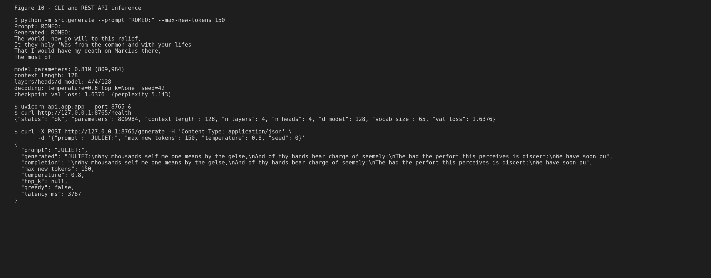
*Figure 10 — CLI and API inference calls against the committed checkpoint.*

**Deployment.** `render.yaml` is a Render blueprint. It installs the *CPU-only* PyTorch wheel (about 200 MB instead of 2 GB with CUDA), installs `requirements-api.txt`, and runs `uvicorn api.app:app`. The 3.3 MB checkpoint ships in the repository, so the service needs no external storage and starts on Render's free tier. Torch is pinned to 1 thread, matching the free instance's single vCPU. Locally, 150 characters took 3.8 s on one thread (about 25 ms per character). Every new character re-runs the full forward pass over the window, because we do not cache keys and values. A KV cache is the obvious next optimisation.

**Reproducibility.** From a clean checkout: `pip install -r requirements.txt` → `python -m pytest` (18 tests: attention, mask, shapes, overfit gate, API/checkpoint reload) → `python -m src.generate`. Every figure and table in this report is produced by a documented command (README, "Reproduce every figure"). Seeds are fixed. No secrets exist in the project, and the dataset and ablation checkpoints are git-ignored. The Colab notebook runs the same sequence, including an optional GPU re-train.

## 10. Conclusion

A 0.81M-parameter Transformer, built from scratch and trained for 71 minutes on a laptop CPU, learned the next-character structure of Shakespeare. Validation perplexity fell from 65 to 5.13, and its samples reproduce the format, meter, archaic vocabulary and speaker conventions of the corpus. It does not reproduce meaning: sentences are locally plausible but globally incoherent, and it invents words. So the answer to our lead engineer's question is: **yes for style and vocabulary, not yet for coherent content at this scale.**

The experiments tie each component to measurable behaviour:
* **Attention's parallelism** made it 4–7× faster than a recurrent loop, but at an O(T²) memory cost (§2.1).
* **The causal mask is what makes the objective meaningful.** Without it, a model reaches 0.05 loss by copying the answer and cannot generate (§2.7).
* **Position information matters, and its form matters** under a small budget: sinusoidal beat learned (§7.4).
* **Depth gave the clearest gains** of the architectural factors, at a linear cost in time and parameters. The head count made almost no difference at fixed width (§7.1–7.2).
* **The trained attention heads specialise** into local n-gram readers and a line-start anchor (Figure 7).

The clearest next steps follow from the failure analysis: a subword tokenizer, a longer context with a KV cache, and more data.

---

## References

1. A. Vaswani et al., "Attention Is All You Need," NeurIPS 2017. *(scaled dot-product attention, multi-head attention, sinusoidal encoding)*
2. A. Radford et al., "Language Models are Unsupervised Multitask Learners," OpenAI 2019. *(GPT-2: decoder-only causal LM, pre-LN, learned positions)*
3. J. Devlin et al., "BERT: Pre-training of Deep Bidirectional Transformers for Language Understanding," NAACL 2019. *(masked LM, 15% masking)*
4. R. Xiong et al., "On Layer Normalization in the Transformer Architecture," ICML 2020. *(pre-LN vs post-LN)*
5. T. Brown et al., "Language Models are Few-Shot Learners," NeurIPS 2020. *(AdamW β₂ = 0.95, cosine schedule)*
6. A. Karpathy, char-rnn (2015), Tiny Shakespeare `input.txt`; Hugging Face dataset card `tiny_shakespeare`. *(data)*
7. A. Karpathy, nanoGPT (2023). *Consulted for training conventions: 0.02 weight init, AdamW betas, warm-up + cosine. No code was copied. Our attention, heads, block and model were written from the equations above.*
8. Course lessons 01–07 (Why Transformers, Self-Attention, Multi-Head Attention, Positional Encoding, Full Transformer, BERT MLM, GPT Causal LM).

**Use of AI tools.** As the assignment permits, we used an AI coding assistant to help write and review code and prose. Every equation, number and figure in this report was produced by the code in the repository and checked by us. The hand calculation was done by hand and verified both by the script and by a unit test. We can explain and defend every component.

## Appendix — Figure checklist

| # | Evidence | Where |
|---|---|---|
| 1 | Hand-calculated attention | §2.3, `fig1_hand_attention.png` |
| 2 | Causal mask matrix / heatmap | §2.3, `fig2_causal_mask_hand.png`; trained model: Figure 7 |
| 3 | Multi-head tensor-shape printout | §2.4, `fig3_shape_trace.png` |
| 4 | Positional encoding visualisation | §2.5, `fig4_positional_encoding.png` |
| 5 | Model summary / parameter count | §6, `fig5_model_summary.png` |
| 6 | Training vs validation loss | §6, `loss_curve_tiny_gpt.png` |
| 7 | Attention of the trained model | §6, `fig7_attention_trained.png` |
| 8 | Generation samples | §6, `fig8_generation_samples.png` |
| 9 | Ablation table / plot | §7, `ablation_val_curves.png` |
| 10 | CLI / API inference call | §9, `fig10_api_call.png` |
